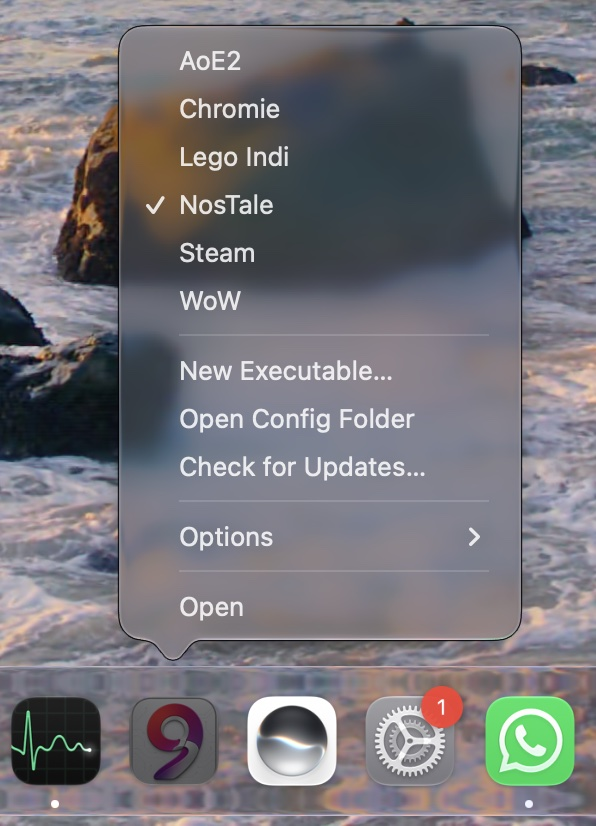

# Mach9.app

Mach9.app runs Windows games on Mach9 ([README](../README.md)). It is made
for older games; newer ones run too, but they already run well under
CrossOver. It needs a Mac with Apple silicon and a recent macOS; macOS
tells you when yours is too old to open it.

## Install

1. Download [Mach9.dmg](https://updates.mach9.app/Mach9.dmg) and drag
   Mach9 to Applications. It does not update itself when started from the
   disk image.
2. Open it from Applications. macOS shows "Background Items Added", which
   means the Dock menu is set up. With no game added yet, Mach9 asks for
   one (see [Add a game](#add-a-game)).
3. Right-click its Dock icon and choose Options, Keep in Dock.

Once Mach9 is in the Dock and not running, right-clicking its icon shows
the Dock menu:

  

## Add a game

Choose New Executable… in the Dock menu. The window has these fields:

- Name: the name in the Dock menu. Left empty, it is the executable's
  name.
- Executable: the Windows `.exe`, typed or picked with Choose….
- Arguments: the arguments passed to it.
- Environment: environment variables, one `NAME=value` per line.
- Save as new game: on by default. Turn it off to run something once,
  such as an installer, without adding it to the menu.

Run starts it.

Install games into a normal macOS folder such as `~/Games`, not into the
prefix's `C:` drive, so they survive a prefix reset. Windows installers see
the root of your Mac as drive `Z:`, so that folder is
`Z:\Users\<you>\Games\<Game>`. When the installer is done, add the
installed game's `.exe` with Save as new game on.

Steam works the same way:

1. Run the Windows Steam installer with Save as new game off.
2. Install it to `Z:\Users\<you>\Games\Steam`.
3. Add `steam.exe` from `~/Games/Steam` as a game.

Steam's library then also lives outside the prefix.

## Play

The checked game in the Dock menu is the selected one. Clicking the Dock
icon starts it, and choosing another game in the menu selects and starts
that one. While a game runs, the Dock shows the normal menu of a running
app, so switch games between sessions.

## Settings

Open Config Folder shows `~/Library/Application Support/app.mach9/`:

- `gamelauncher.toml`: the defaults every game starts from.
- `games/<Name>.toml`: one file per game. Renaming the file renames the
  game.
- `prefix/`: the Wine prefix, shared by all games.
- `gamelauncher.log`: the output of the last launch.

Comments in `gamelauncher.toml` and in each game file explain every option.

To reset the prefix, quit all games and delete `prefix/`. The next launch
creates a new one. Games installed outside it keep working.

## Updates

Mach9 checks for updates from time to time when it starts. Check for
Updates… in the Dock menu checks right away.

## When something goes wrong

- The Dock menu shows no games, only Options and Open: open Mach9 once from
  Applications, then remove it from the Dock and add it again.
- A game does not start or crashes: look in `gamelauncher.log` in the
  config folder.
- Report problems in the [issues](https://github.com/athei/mach9/issues),
  with the log attached.
